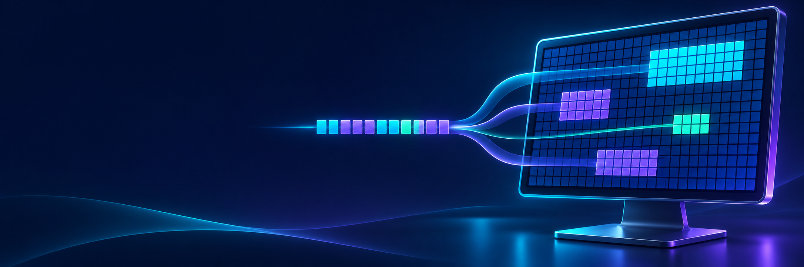
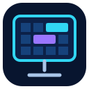
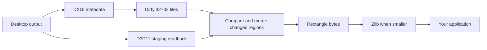

<p align="center">
  
</p>

<p align="center">
  
</p>

<h1 align="center">LX Capture</h1>

<p align="center"><strong>Small, direct DXGI screen capture for Rust on Windows.</strong><br>
Changed tiles in. Ready rectangle bytes out.</p>

<p align="center">
  <a href="https://crates.io/crates/lx-capture"></a>
  <a href="https://docs.rs/lx-capture"></a>
  <a href="https://github.com/younsabood/lx-capture"></a>
  <a href="LICENSE-MIT"></a>
</p>

## What it does

LX Capture is a Windows-only Rust library built on **DXGI Desktop Duplication**. It reads the selected desktop output, uses DXGI dirty and move metadata to limit readback, compares a 32×32 tile grid, then returns a full keyframe or changed command-0 rectangle updates. Payloads use lossless zlib when compression makes them smaller.

The library returns image bytes to the caller. It does not provide a UI, write a recording container, capture audio, or send data over a network.

| Capability | Behavior |
| --- | --- |
| Capture backend | DXGI Desktop Duplication with a D3D11 staging texture |
| Updates | Initial full-screen keyframe, then changed rectangles; unchanged frames return `None` |
| High Color | RGB555 packed into a little-endian 16-bit word |
| True Color | BGR24 packed as three bytes per pixel |
| Compression | Zlib level 9 when the result is smaller; otherwise raw bytes |
| Scope | One desktop output selected by the library; no UI or file/network I/O |

## Capture path



Editable source: [capture-flow.mmd](docs/diagrams/capture-flow.mmd).

## Add it to a Rust project

```toml
[dependencies]
lx-capture = "0.1"
```

The crate compiles its screen-capture API for Windows. `ScreenRect` and rectangle validation are available on other targets, but DXGI capture types are Windows-only.

## Capture and read updates

```rust,no_run
use std::{thread, time::{Duration, Instant}};
use lx_capture::{CaptureColorDepth, ScreenCaptureSession};

fn main() -> Result<(), String> {
    let (mut capture, keyframe) =
        ScreenCaptureSession::start(CaptureColorDepth::HighColor, 0)?;
    println!("{}×{} keyframe: {} bytes", capture.dimensions().0,
        capture.dimensions().1, keyframe.payload.len());

    let start = Instant::now();
    while start.elapsed() < Duration::from_secs(10) {
        thread::sleep(Duration::from_millis(200));
        let timestamp_ms = start.elapsed().as_millis() as u64;
        if let Some(update) = capture.capture_next(timestamp_ms)? {
            println!("{} changed tiles, {} rectangles, {} bytes",
                update.dirty_blocks, update.rects.len(), update.payload.len());
            // Consume `update.payload` here. LX Capture leaves storage and
            // recording formats to the application.
        }
    }
    Ok(())
}
```

More examples and implementation details:

| Guide | Contents |
| --- | --- |
| [Quick start](docs/quickstart.md) | Windows setup and a complete capture loop |
| [API and byte format](docs/api.md) | Color layouts, rectangle headers, compression, and keyframes |
| [Architecture](docs/architecture.md) | DXGI readback, move/dirty rectangles, tile comparison |
| [Security and privacy](docs/security.md) | Data flow, unsafe boundary, and caller responsibilities |
| [Diagrams](docs/diagrams/README.md) | Mermaid sources for capture and payload layout |
| [All documentation](docs/README.md) | Documentation index |

## Build and check

Use a Windows MSVC Rust toolchain for DXGI capture:

```powershell
cargo check --locked
cargo test --locked
cargo run --locked --example capture_updates
```

See [Contributing](CONTRIBUTING.md) for formatting and review guidance. See [Security](SECURITY.md) for vulnerability reporting and [Third-party notices](THIRD-PARTY-NOTICES.md) for dependency license metadata.

## License

Licensed under either the [MIT License](LICENSE-MIT) or [Apache License 2.0](LICENSE-APACHE), at your option.
