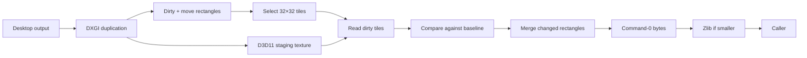

# Architecture

LX Capture uses Windows DXGI Desktop Duplication and D3D11 staging readback. The current implementation selects one output attached to the desktop, preferring the output whose origin is `(0, 0)`. Rotated outputs are rejected with an error.

## Capture path

1. Create a DXGI factory, select an adapter/output, create a D3D11 device, and duplicate the output.
2. Acquire the initial frame and read the whole surface to seed the CPU-side pixel buffer.
3. For each later frame, read DXGI move and dirty rectangle metadata.
4. Apply move rectangles to the in-memory image and copy only dirty 32×32 tiles from the staging texture.
5. Compare the selected tiles against the last emitted baseline, merge touching rectangles, and trim unchanged borders.
6. Encode a command-0 rectangle stream and keep its zlib form only if it is smaller.

The library leaves frame pacing to the caller. `capture_next` polls DXGI without waiting for a new frame; callers choose when to poll and when to flush pending changes.

## State and memory

`DxgiCapture` owns the DXGI duplication object, D3D11 context, staging texture, and current packed image. `ScreenEncoder` maintains the last emitted image as the comparison baseline. A frame lease releases each acquired duplication frame when its scope ends, including early-return paths.

Move rectangles update the CPU-side image before dirty tiles are read back. The emitted delta still contains destination pixels; LX Capture does not emit a separate copy-rectangle command.

## Encoding choices

High Color uses two bytes per pixel; True Color uses three. Keyframes and large deltas are compressed with zlib level 9. Very small updates can stay raw, and any compressed result that is not smaller is discarded. `encode_png_frame` is a separate helper for callers that need a standalone RGB8 PNG.

## Diagrams

- [Capture flow source](diagrams/capture-flow.mmd)
- [Rectangle payload source](diagrams/rectangle-payload.mmd)

See [API and byte format](api.md) for the exact pixel and payload layout.
